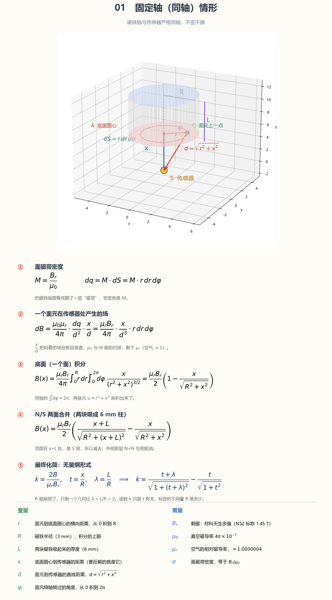

# 01 用在哪 / 01 Usage

`k` 关于 `t` 和 `λ` 的式子用于确定**基准Br**。由于 CAD 内已知磁铁到传感器霍尔面的气隙距离，可以带入 `x` ，再附加此次测得的 `B(x)` 求出 Br。

但装配时肯定无法保证磁铁轴和传感器的位置准度。不过好在实际测试发现微小的偏移不会对测得的 Br 造成太大变化：

- 偏 0.2 毫米，读数只差 0.1%。偏 1 毫米，读数差 2.5%
- 歪 2 度差 0.03%，歪 5 度才 0.14%

所以装不正，对 Br 的影响不到千分之一。三颗的 Z 一起平均，还可以再降低一点误差。所以校准后的等效Br基本算是可信的。后续的3D位置检测都将基于此校准。

## 更可靠的办法

也许在经过大量使用之后，气隙已经和原来的5.84相差甚远，也许可以在摇杆垫一片已知厚度 h 的专用于校准的薄片，测量两次 `B(x)`。两次间隙差固定是 h，两条式子联立，将 Br 和 x 一起解出来。这样还可确定初始位置 x。

不过这就会更麻烦。
