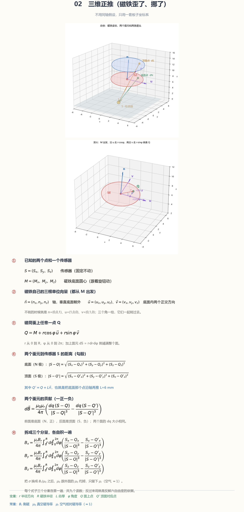

# 02 三维正推用在哪 / 02 Usage

01 是 02 在 `n=(0,0,1)`、`u,v` 正对、Q 落在轴上的特例。02 把这个限制去掉。

只用板子XYZ坐标系。原点是三颗传感器的中心，x 朝右，y 朝上，z 朝板子正面法向。所有量都写在同一套轴里，所以可以直接相加减。

---

首先，这个物理模型的输入是：**`磁铁底面圆心位置`**和**磁铁在XYZ坐标系中的三个旋转角`rx`，`ry`，`rz`**。

输出是该磁铁所属的传感器的：**`预期B(x)`、`预期B(y)`、`预期B(z)`**

已知的量有：

| 量 | 是什么 |
|---|---|
| R, L | 常量（3 mm, 6 mm） |
| Br | 常量，用 01 标定出来的等效值 |
| S₁, S₂, S₃ | 常量（板子上焊死的） |

02 三维正推就是单次计算的过程。输入磁铁的位置和角度，输出传感器处应有的磁强。可实际上我们能得到的和要求的东西恰好是反过来的。这个反过来解算的事是 03 反推的。03 需要用到 02 来做迭代。

---

磁铁是根圆柱。它有：

| 符号 | 是什么 | 初始静止值 |
|---|---|---|
| `M = (Mx, My, Mz)` | 磁铁底面圆心 | （见[坐标系图](/Software/Orbi%20Algorithm/Physics/Magnet%20position%20relative%20to%20sensor%20hall%20plane.jpg)）（注意！Z距离霍尔面已更改为5.85，图中5.00是旧值） |
| `n = (nx, ny, nz)` | 磁铁轴的方向，N指向S（或者说是从底面朝向顶面） | (0, 0, 1) |
| `u = (ux, uy, uz)` | 底面内的一个方向 | (1, 0, 0) |
| `v = (vx, vy, vz)` | 底面内另一个方向，跟 u 垂直 | (0, 1, 0) |
| `R` | 磁铁半径 = 3 mm | const 3 |
| `L` | 两块 6×3 叠起来的总厚 = 6 mm | const 6 |

坐标变换：**n、u、v是用于先在磁铁系中积分磁荷面，然后使用n、u、v完成到XYZ坐标系的转换。** 磁铁一歪它们三个分量都有值。两个角（`rx`, `ry`）管 `n` 指哪，第三个角（`rz`）管 `u`、`v` 在底面里怎么转。需要使用旋转矩阵。

## 代码实现的区别

`|S−Q|` 距离里面有 cosφ 和 sinφ，`∫dφ` 积不出初等函数。

所以实际代码做法需要预先切碎磁荷面相加：

- r 方向切几圈
- φ 方向每圈切几份
- 每小块按质心位置算一次，乘上它的面积，就是一个面磁荷
- 相加所有面磁荷

8 圈 × 16 份 = 128 片，两个面 256 片。已经足够精细了。
